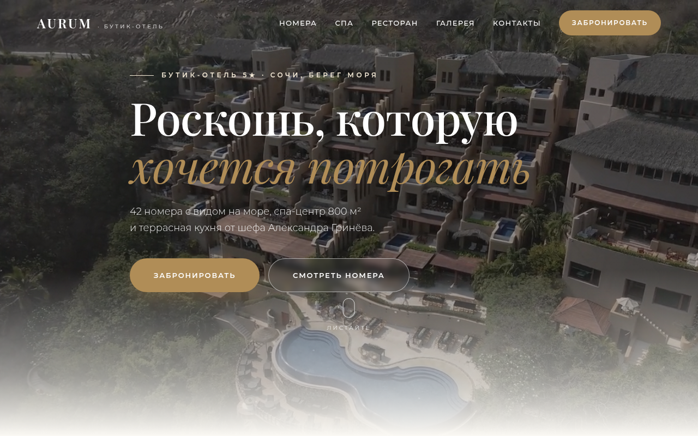
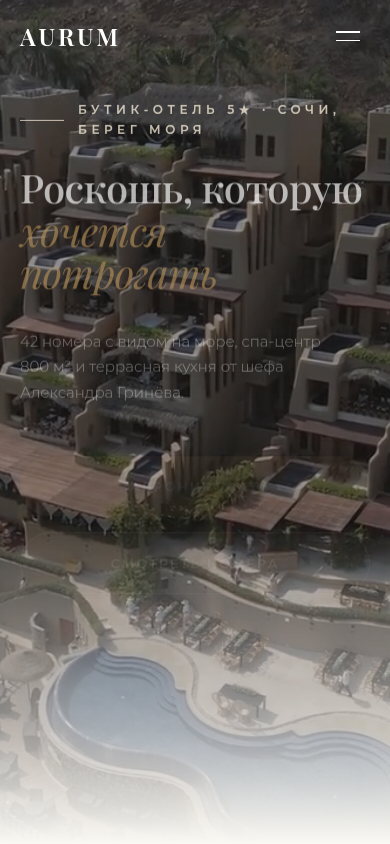

# AURUM — концепт-сайт бутик-отеля 5★

## Демо

**[Открыть сайт →](https://shalim-andrej.github.io/aurum/)**




Премиальный одностраничник вымышленного бутик-отеля AURUM в Сочи: номера у моря, СПА, ресторан, онлайн-бронирование. Кейс о том, как сайт отеля продаёт не комнаты, а впечатление — через воздух, вид и паузы в вёрстке.

**Демо:** [shalim-andrej.github.io/aurum](https://shalim-andrej.github.io/aurum/)

## Визуальный язык

- Светлая «курортная» палитра: натуральные материалы, море, солнце
- Крупные фотографии-панорамы с мягкими blur-слоями
- Видео-обложка в первом экране
- Щедрые отступы и разреженный трекинг заголовков — эффект «дыхания»

Каждый проект в премиум-пятёрке имеет собственную сетку и палитру — AURUM отвечает в связке за «отдых и простор».

## Структура страницы

| Блок | Содержание |
|---|---|
| Первый экран | видео-обложка, вид на море |
| Номера | категории и выбор при брони |
| Спа | программы и процедуры |
| Ресторан | кухня отеля |
| Галерея | фотографии отеля и территории |
| Контакты | адрес и связь |
| Бронирование | форма: имя, телефон, даты, тип номера, гости |

## Что внутри технически

- **HTML5-видео** в hero-секции
- **Glassmorphism** — панели и карточки на `backdrop-filter`
- **Параллакс** — слои, привязанные к скроллу
- **Reveal-анимации** на IntersectionObserver + кастомные `@keyframes`
- **CSS Grid** и кастомные свойства, fluid-типографика на `clamp()`
- **Адаптив** всех блоков, `loading="lazy"` для изображений
- **Open Graph** разметка и `meta description`
- **Ноль зависимостей** — vanilla JS, стили и скрипты написаны с нуля

## Запуск локально

```bash
git clone https://github.com/shalim-andrej/aurum.git
cd aurum
```

Откройте `index.html` в браузере — сборка и зависимости не нужны.

## Автор

Разработчик — Андрей Шалимов ([@shalim-andrej](https://github.com/shalim-andrej)).
Заказать сайт: [Kwork](ССЫЛКА_НА_ПРОФИЛЬ_KWORK)

> Проект демонстрационный: бренд вымышленный, сайт создан как портфолио-кейс.